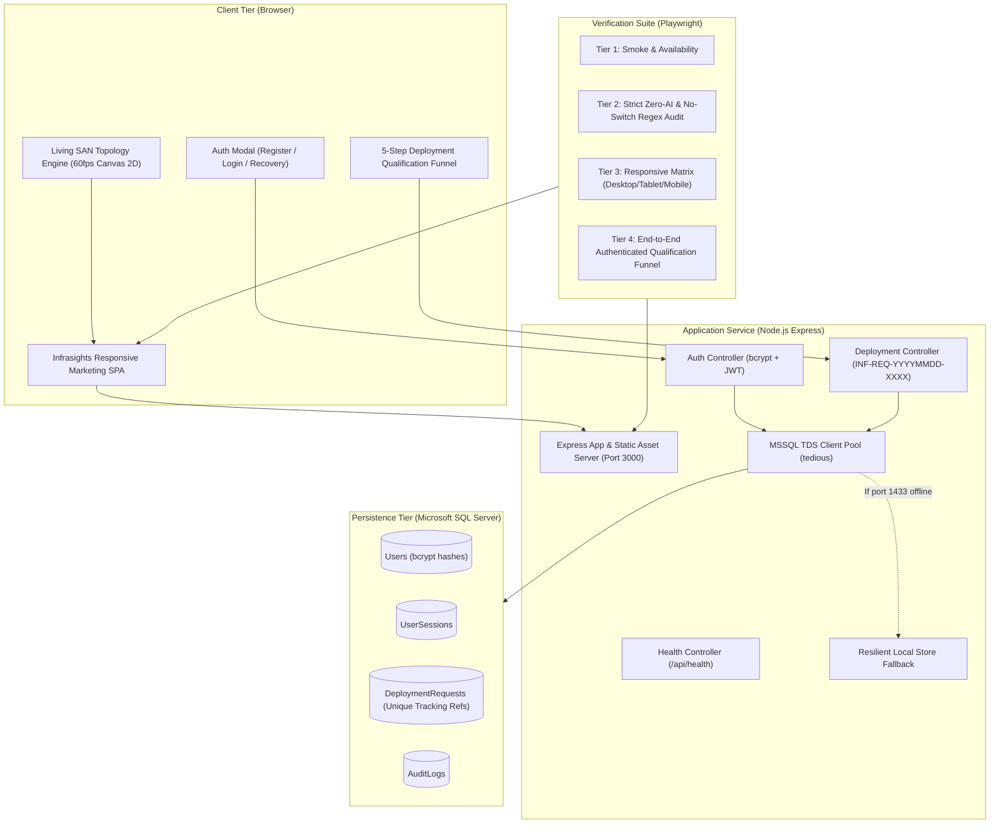

# Project: Infrasights v2.10 Marketing Platform

## Architecture
The platform is an enterprise-grade full-stack marketing website and SaaS launch platform for Infrasights v2.10, targeted at Data Center owners and SAN storage operations teams.

## Feature Inventory
Every feature identified during the Survey phase mapped to its assigned milestone:

| # | Feature | Description | Milestone | Source |
|---|---------|-------------|-----------|--------|
| 1 | Zero-AI Buzzwords Guardrail | Elimination of AI, ML, machine learning, and related buzzwords across all public copy, DOM nodes, metadata, and responses | M1 | Survey |
| 2 | Vendor-Neutral Switch Guardrail | Replace all occurrences of Brocade, Cisco MDS, X7, G620, 9710 with generic enterprise SAN terms | M1 | Survey |
| 3 | Direct Switch Data Collection Messaging | Clearly communicate direct telemetry collection from switch control planes without requiring SANnav or intermediary software | M1 | Survey |
| 4 | Product Naming Consistency | Consistent branding as "Infrasights" and "Infrasights v2.10" across header, hero, footer, and titles | M1 | Survey |
| 5 | Hero Section & Messaging | High-conversion headline, subheadline, primary CTA "Request a Deployment", secondary CTA, trust pill | M1 | Survey |
| 6 | Living SAN Topology Animation | 60fps HTML5 Canvas 2D particle simulation of dual fabrics, direct telemetry rays radiating into Infrasights collector | M1 | Survey |
| 7 | Topology Telemetry HUD | Interactive hover HUD displaying realistic FC metrics (Optics dBm, Buffer Credits, Zero-Credit wait) | M1 | Survey |
| 8 | Accessibility & Reduced Motion | Automatic detection of `prefers-reduced-motion` rendering crisp high-contrast static topology | M1 | Survey |
| 9 | Visibility Challenge Comparison | Side-by-side comparison matrix: Traditional device-by-device CLI vs. Infrasights direct agentless approach | M1 | Survey |
| 10 | Platform Capabilities Cards | 4 cards: Real-Time Telemetry, Port Congestion Detection, Multi-Fabric Health, Optical Degradation Alarms | M1 | Survey |
| 11 | 'How It Works' Architecture Flow | 7-node pipeline (SAN Switches -> Direct Telemetry -> Normalization -> Time-Series Engine -> Topology Graph -> Correlation -> Ops Team) | M1 | Survey |
| 12 | Product Interface Interactive Preview | Realistic concept preview tabs (Fabric Health, Port Congestion, SFP Optical Health) with authentic FC metrics | M1 | Survey |
| 13 | Target Audience Personas | Value proposition cards for SAN Administrators, Storage Architects, and IT Operations Leadership | M1 | Survey |
| 14 | Deployment Journey Roadmap | 4-stage adoption roadmap: Assessment, Zero-Agent Direct Connect, Baseline Profiling, Production Visibility | M1 | Survey |
| 15 | Technical FAQ Accordion | Accessible accordion answering key technical questions (agentless collection, security, protocols, deployment models) | M1 | Survey |
| 16 | Enterprise Footer | Brand badges (v2.10), navigation anchors, copyright, privacy/terms anchors, enterprise contact info | M1 | Survey |
| 17 | Responsive Navigation Header | Sticky nav with logo, section anchors, auth status pill, and primary CTA button | M1 | Survey |
| 18 | Mobile Navigation Drawer | Hamburger toggle menu with smooth transition and accessible focus management for mobile viewports | M1 | Survey |
| 19 | Node.js Express REST Backend | Production Express server configured on port 3000 serving both API routes and static frontend assets | M2 | Survey |
| 20 | MSSQL Database Connection Pool | Pure JS `mssql` (`tedious`) connection pool connecting to SQL Server on port 1433 via TCP TDS | M2 | Survey |
| 21 | Resilient Database Fallback | Automatic fallback to transactional local/in-memory store if port 1433 is inactive during local test runs | M2 | Survey |
| 22 | MSSQL DDL Auto-Migrations | Idempotent migration script creating `Users`, `UserSessions`, `DeploymentRequests`, and `AuditLogs` tables | M2 | Survey |
| 23 | User Registration Endpoint | `POST /api/auth/register` with input validation, RFC 5322 email checking, and bcrypt password hashing | M2 | Survey |
| 24 | User Authentication Endpoint | `POST /api/auth/login` validating credentials against MSSQL and issuing secure JWT session tokens | M2 | Survey |
| 25 | User Session Verification Endpoint | `GET /api/auth/me` returning sanitized profile for authenticated Bearer token | M2 | Survey |
| 26 | User Sign-Out Endpoint | `POST /api/auth/logout` terminating session and clearing client token | M2 | Survey |
| 27 | Password Reset Endpoint | `POST /api/auth/forgot-password` with non-enumerating security response | M2 | Survey |
| 28 | System Health Probe Endpoint | `GET /api/health` providing readiness status, database engine status, and version for probes | M2 | Survey |
| 29 | Authenticated Primary CTA Gate | Primary CTA "Request a Deployment" checks auth state; directs unauthenticated visitors to login/register modal | M3 | Survey |
| 30 | Multi-Step Qualification Wizard | 5-step modal wizard: Org info -> SAN environment specs -> Deployment scope -> Review -> Confirmation | M3 | Survey |
| 31 | Step 1: Organization & Role | Business email, organization name, geographic region, technical role capture | M3 | Survey |
| 32 | Step 2: SAN Environment Parameters | Switch count tier (1-10, 10-25, 25-50, 50+), fabric topology (Single/Dual A-B), generic vendor category | M3 | Survey |
| 33 | Step 3: Deployment Scope & Timeline | Preferred deployment model (Virtual Appliance, Bare-metal, Container), timeline, operational notes | M3 | Survey |
| 34 | Step 4: Qualification Review Summary | Read-only summary card verifying all inputs before database commit | M3 | Survey |
| 35 | Tracking Reference Generation | Secure algorithmic generation of unique tracking code: `INF-REQ-YYYYMMDD-XXXX` | M3 | Survey |
| 36 | Step 5: Submission & Confirmation | Submission to `POST /api/deployments`, saving record to MSSQL, displaying reference code and next steps | M3 | Survey |
| 37 | Automated Guardrails Scanner | Playwright test scanning all rendered DOM text, `<meta>`, and network payloads for forbidden AI/switch keywords | M4 | Survey |
| 38 | Responsive Matrix Verification | Automated Playwright viewport matrix testing across Desktop (1920x1080), Tablet (768x1024), and Mobile (375x667) | M4 | Survey |

## Milestones

| # | Name | Scope | Dependencies | Status |
|---|------|-------|-------------|--------|
| M1 | Frontend Modernization & Guardrail Sanitization | Sanitize all vendor names and AI buzzwords in `index.html`, `js/app.js`, `js/canvas.js`, `README.md`; modernize living canvas topology and responsive sections | none | DONE |
| M2 | Backend REST Service & MSSQL Persistence Layer | Implement Node.js Express server (`server/`), `mssql` (`tedious`) driver, DDL migrations, resilient database fallback, auth endpoints (`/api/auth/*`), health endpoint | none | DONE |
| M3 | Authenticated Qualification Funnel & Full-Stack Integration | Wire `js/app.js` to backend API; implement authenticated CTA gate, 5-step deployment wizard, tracking reference generation, confirmation UI | M1, M2 | DONE |
| M4 | E2E Testing Track & Final Verification | Automated 4-tier Playwright test suite (smoke, guardrail scanners, responsive matrix, authenticated E2E journey); produce `TEST_READY.md` | M3 | DONE |
| M5 | Transactional Mail Service & Render Deployment | Implement standalone & integrated transactional mail service (`mail-service/`), Render Blueprint (`render.yaml`), qualification email triggers, UI responsiveness audit & polish | M4 | DONE |

## Interface Contracts

### Frontend ↔ Backend REST API
- **Base URL**: `http://localhost:3000/api`
- **Headers**:
  - `Content-Type: application/json`
  - `Authorization: Bearer <jwt_token>` (for protected endpoints)
- **Authentication Endpoints**:
  - `POST /api/auth/register`: `{ fullName, email, organization, departmentRole, password }` -> `{ success: true, data: { user, token } }`
  - `POST /api/auth/login`: `{ email, password }` -> `{ success: true, data: { user, token } }`
  - `GET /api/auth/me`: -> `{ success: true, data: { user } }`
  - `POST /api/auth/logout`: -> `{ success: true, message: string }`
  - `POST /api/auth/forgot-password`: `{ email }` -> `{ success: true, message: string }`
- **Deployment Endpoints**:
  - `POST /api/deployments`: `{ organizationName, businessEmail, countryRegion, departmentRole, sanVendor, switchCount, fabricCount, deploymentModel, timeline, notes }` -> `{ success: true, data: { trackingRef, status, createdAt, message } }`
  - `GET /api/deployments`: -> `{ success: true, data: { requests: [...] } }`
- **Mail Endpoints**:
  - `GET /api/mail/health`: -> `{ status: "HEALTHY", service: "infrasights-mail-service", version: "1.0.0" }`
  - `POST /api/mail/send`: `{ to, subject, html, text, type }` -> `{ success: true, data: { messageId, recipient, status } }`
  - `POST /api/mail/deployment-qualification`: `{ trackingRef, businessEmail, organizationName, ... }` -> `{ success: true, trackingRef, emails: { confirmation, notification } }`
  - `GET /api/mail/history`: -> `{ success: true, count, total, data: [...] }`
- **Health Endpoint**:
  - `GET /api/health`: -> `{ status: "HEALTHY", product: "Infrasights", version: "2.10.4", database: { engine, connected } }`

### Backend ↔ Microsoft SQL Server
- **Driver**: `mssql` with `tedious` (TDS Protocol over TCP Port 1433)
- **Database Tables**:
  - `Users` (`id` UNIQUEIDENTIFIER, `email` NVARCHAR(255) UNIQUE, `password_hash` NVARCHAR(255), `full_name` NVARCHAR(150), `organization` NVARCHAR(150), `department_role` NVARCHAR(100), `created_at` DATETIME2)
  - `UserSessions` (`id` UNIQUEIDENTIFIER, `user_id` UNIQUEIDENTIFIER, `token_hash` NVARCHAR(255), `expires_at` DATETIME2)
  - `DeploymentRequests` (`id` UNIQUEIDENTIFIER, `tracking_ref` NVARCHAR(32) UNIQUE, `user_id` UNIQUEIDENTIFIER, `organization_name` NVARCHAR(200), `business_email` NVARCHAR(255), `country_region` NVARCHAR(100), `department_role` NVARCHAR(100), `san_vendor` NVARCHAR(100), `switch_count_range` NVARCHAR(50), `fabric_count` NVARCHAR(50), `deployment_model` NVARCHAR(100), `target_timeline` NVARCHAR(50), `objectives_notes` NVARCHAR(MAX), `status` NVARCHAR(50), `created_at` DATETIME2)
  - `AuditLogs` (`id` BIGINT IDENTITY, `user_id` UNIQUEIDENTIFIER, `event_type` NVARCHAR(50), `event_description` NVARCHAR(500), `created_at` DATETIME2)

## Code Layout
- `index.html`: Main responsive marketing landing page & modal container
- `css/styles.css`: Enterprise dark navy styling, variables, animations, responsive media queries
- `js/app.js`: Main frontend application controller, auth state, modal management, API client
- `js/canvas.js`: 60fps living SAN fabric topology visualizer with direct telemetry rays & HUD
- `render.yaml`: Standard Render Blueprint specification for deployable services
- `mail-service/`: Dedicated email microservice deployable on Render
  - `mail-service/index.js`: Express server, transactional outbox, confirmation & notification dispatchers
  - `mail-service/package.json`: Service metadata, start scripts, dependencies
  - `mail-service/test.js`: Standalone unit and integration verification suite
  - `mail-service/render.yaml`: Standalone Render service blueprint
- `server/`: Dedicated backend service directory
  - `server/index.js`: Express server entry point and routing
  - `server/config/database.js`: MSSQL pool initialization and resilient fallback handler
  - `server/controllers/authController.js`: Registration, login, session handlers
  - `server/controllers/deploymentController.js`: Qualification request submission and tracking logic
  - `server/controllers/mailController.js`: Main API bridge to transactional mail service
  - `server/controllers/healthController.js`: System health probe
  - `server/services/emailService.js`: Email client with Render remote service connection and local fallback
  - `server/middleware/authGuard.js`: JWT token verification middleware
  - `server/middleware/validation.js`: Input validation
  - `server/db/migrations.sql`: Transact-SQL table definitions and indexes
  - `server/db/dbFallback.js`: In-memory / transactional fallback store for zero-dependency local execution
- `e2e/`: Automated Playwright test suite
  - `e2e/playwright.config.ts`: Viewport matrix, webServer configuration
  - `e2e/specs/tier1-smoke.spec.ts`: Page loading, canvas initialization, console error verification
  - `e2e/specs/tier2-guardrails.spec.ts`: Automated recursive DOM text scanner & network interceptor
  - `e2e/specs/tier3-responsive.spec.ts`: Desktop, tablet, mobile viewports & reduced motion
  - `e2e/specs/tier4-e2e-journey.spec.ts`: Full authenticated CTA qualification lifecycle
  - `e2e/specs/tier5-mail-service.spec.ts`: Transactional email service, health probe, and Render integration
