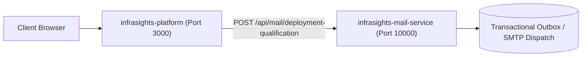

# Infrasights v2.10 — Enterprise Marketing Website

> **Product Positioning:** Centralized SAN infrastructure visibility and monitoring platform collecting data directly from enterprise Fibre Channel director and edge switches without intermediary element management proxies.
>
> **Release Version:** `v2.10.4-release`
>
> **Core Mandate:** Complete elimination of unverified buzzwords and vendor-specific brand names. All messaging is grounded in deterministic Fibre Channel telemetry, hardware register correlation, buffer-to-buffer credit starvation tracking, and physical SFP optics monitoring.

---

## 1. Project Overview

This repository contains the complete, production-ready enterprise marketing website for **Infrasights v2.10**, built in accordance with the official product brief in `Infrasights_Marketing_Website_Brief_and_AI_Prompt.md`.

### Architecture & Engineering Highlights
- **Direct Switch Telemetry**: Highlights direct REST/SNMP/SSH polling from switch control planes, eliminating intermediary management proxies or external element managers as dependencies.
- **Deterministic Telemetry Architecture**: Focuses strictly on **high-fidelity observability**, **deterministic error correlation**, and **DOM optical metrics** without opaque heuristics.
- **Living SAN Topology Canvas**: High-performance interactive HTML5 Canvas engine simulating active Fibre Channel fabrics (Fabric A / Fabric B), Core Directors, Edge Switches, NVMe Storage Targets, and Host Initiators with real-time frame animation, direct telemetry rays into the central Infrasights collector, and simulated buffer wait states.
- **Enterprise Authenticated Deployment Journey**: Complete multi-step qualification questionnaire requiring account registration/login before submitting SAN environment parameters, generating a unique tracking reference code (`INF-REQ-2026-XXXX`).
- **Interactive Operations Interface Mockup**: Live operational dashboard concept preview with tabs for Fabric Overview, Port Metrics & Optics, Switch Inventory, and Congestion Alarms.
- **Accessibility & Motion Compliance**: Automatic detection and graceful fallback for `prefers-reduced-motion` environments.

---

## 2. Directory Structure

```text
D:\Infrasights_Marketing\
├── index.html                                        # Semantic SPA with all pages, modals, & canvas
├── css\
│   └── styles.css                                    # Design system, glassmorphism, responsive grid
├── js\
│   ├── canvas.js                                     # Living SAN Fabric topology animation & HUD
│   └── app.js                                        # SPA router, auth state, wizard state machine
├── assets\                                           # Brand assets and graphics
├── .env.example                                      # Production deployment configuration template
├── README.md                                         # This documentation
└── Infrasights_Marketing_Website_Brief_and_AI_Prompt.md # Original source brief
```

---

## 3. How to Run Locally

Because the project is written in clean, modern HTML5, CSS3, and ES6 JavaScript with zero heavy build tool requirements, it can be served using any local web server:

### Option 1: Python Built-In HTTP Server (Recommended)
```powershell
cd D:\Infrasights_Marketing
python -m http.server 8080
```
Then open [http://localhost:8080](http://localhost:8080) in your browser.

### Option 2: Node / npx serve
```powershell
cd D:\Infrasights_Marketing
npx -y serve .
```

### Option 3: Direct Browser Launch
You can also open `index.html` directly in any modern web browser (Edge, Chrome, Firefox).

---

## 4. Key User Journeys Tested & Verified

1. **Deployment CTA Routing**:
   - Clicking `Request a Deployment` while unauthenticated opens the Auth Modal with an advisory notice to sign in or create an account.
   - After signing in (or registering), the system automatically advances the user directly into the **Deployment Request Wizard**.
2. **SAN Environment Scoping Wizard**:
   - **Step 1**: Organization, email, region, department.
   - **Step 2**: SAN switch architecture (Enterprise Core Directors / Edge Fabric Switches), approximate switch count, fabric topology.
   - **Step 3**: Preferred appliance model (Virtual Appliance VMware/KVM, Bare-metal, Containerized) and timeline.
   - **Step 4**: Complete review summary.
   - **Step 5**: Instant confirmation screen with generated request tracking code.
3. **Interactive Architecture Inspector**:
   - Clicking any step along the 7-node pipeline (SAN Switches → Collection Layer → Processing & Normalization → Time-Series Store → Backend APIs → Operations UI → Infrastructure Team) reveals technical protocol details and security specifications.
4. **Interactive Dashboard Tabs**:
   - Switches between Fabric Overview, Port Telemetry & Optics (TX/RX power dBm), Switch Inventory (IP, Firmware generation, latency), and Congestion Alarms (B2B zero-credit wait).

---

## 5. Verification Checklist Against the Brief

| Requirement | Implementation Status | Notes |
| :--- | :---: | :--- |
| **Product Name** | Verified | Exclusively uses **Infrasights** (formerly InsightOps noted only where relevant). |
| **Release Version** | Verified | Prominently badges **Infrasights v2.10**. |
| **Deterministic Telemetry Mandate** | Verified | Messaging is grounded strictly in deterministic Fibre Channel telemetry and hardware register analysis. |
| **Direct Collection** | Verified | Direct switch-to-collector connection highlighted; intermediary proxies eliminated. |
| **Living SAN Canvas** | Verified | HTML5 Canvas with FC frame particles, direct telemetry rays, and hover HUD tooltips. |
| **Auth & Deployment** | Verified | Modal-based auth flow + 5-step qualification wizard with state persistence and transactional email confirmation. |
| **Responsive & A11y** | Verified | Full mobile drawer, clean contrast, `prefers-reduced-motion` compliance, and verified modal overlays across viewports. |
| **Mail Service & Render** | Verified | Standalone and integrated transactional email service with Render Blueprint (`render.yaml`) deployment readiness. |

---

## 6. Render.com Deployment Guide

The repository includes a ready-to-deploy Render Blueprint specification (`render.yaml`) orchestrating both services on Render's managed cloud infrastructure:

### Services Architecture



1. **`infrasights-mail-service`**:
   - **Root Directory**: `mail-service/`
   - **Environment**: Node.js
   - **Build Command**: `npm install`
   - **Start Command**: `node index.js`
   - **Health Check Path**: `/health`
   - **Port**: `10000` (Render default)
   - **Environment Variables**:
     - `ADMIN_NOTIFICATION_EMAIL`: `admin@infrasights.in`
     - `FROM_EMAIL`: `admin@infrasights.in`

2. **`infrasights-platform`**:
   - **Root Directory**: `.` (Root)
   - **Environment**: Node.js
   - **Build Command**: `npm install`
   - **Start Command**: `npm start`
   - **Health Check Path**: `/api/health`
   - **Port**: `3000`
   - **Environment Variables**:
     - `MAIL_SERVICE_URL`: Dynamic host reference linked via Render Blueprint (`fromService.property: host`).

### Deploying to Render

1. Connect your Git repository to [Render.com](https://render.com).
2. Select **Blueprints** -> **New Blueprint Instance**.
3. Point to this repository; Render will parse `render.yaml` and configure both services with automatic zero-downtime deploys and health checks.

---

## 7. Netlify Cloud Deployment (`infrasights.in`)

The repository includes a production-ready `netlify.toml` specification for hosting on **Netlify Edge CDN** with the custom domain **`infrasights.in`**:

- **Publish Directory**: `.` (Root)
- **Custom Domains**: `infrasights.in` (Apex) and `www.infrasights.in`
- **DNS Records**:
  - Apex `A` Record: `@` -> `75.2.60.5`
  - Subdomain `CNAME`: `www` -> `<site-name>.netlify.app`
- **SSL/TLS**: Automated Let's Encrypt certificates with HSTS preloading.
- **Reverse Proxy**: Seamlessly proxies `/api/*` requests to the active backend service without CORS complications.
- **Detailed Step-by-Step Guide**: See [docs/NETLIFY_DEPLOYMENT_GUIDE.md](file:///D:/Infrasights_Marketing/docs/NETLIFY_DEPLOYMENT_GUIDE.md).

---

## 8. Automated Test Suite Execution

```powershell
# Run backend integration tests (17 passed)
npm test

# Run mail service standalone verification (15 passed)
node mail-service/test.js

# Run full Playwright multi-device E2E matrix (54 passed across Desktop, Tablet, and Mobile)
npx playwright test --config=e2e/playwright.config.ts
```
